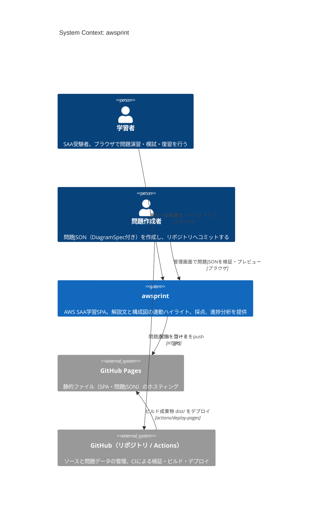
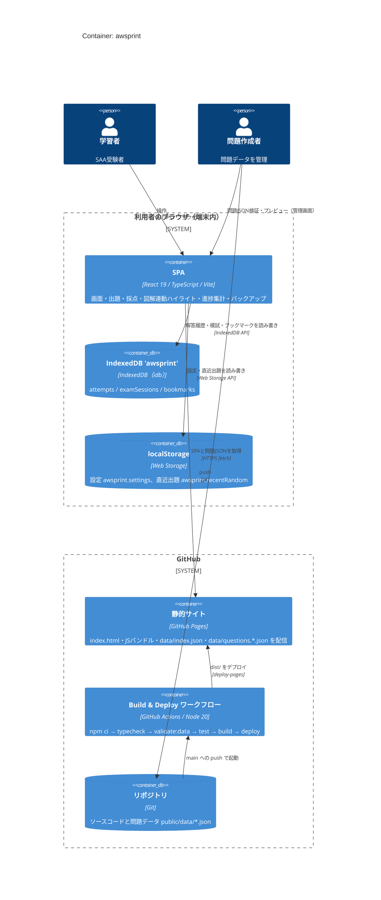
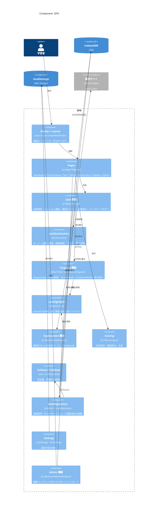
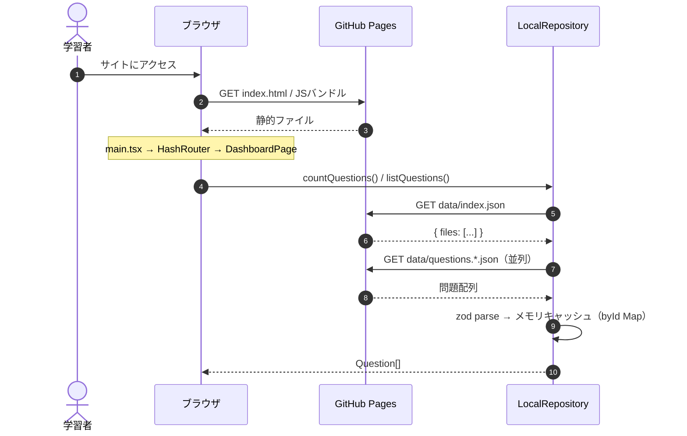
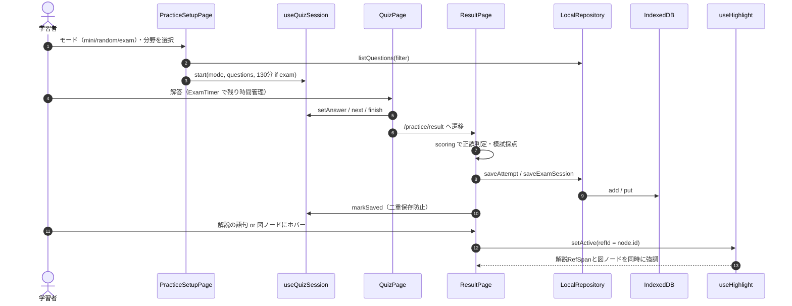
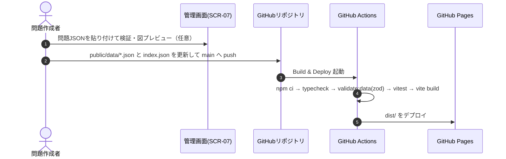

# アーキテクチャ（C4モデル）

本書はリポジトリのコード・設定ファイルを調査し、[C4モデル](https://c4model.com/) に基づいて awsprint の構成を図示したものです。
設計方針・技術選定の経緯は [docs/architecture/overview.md](architecture/overview.md) を参照してください。

> 記述の根拠: `package.json` / `vite.config.ts` / `.github/workflows/deploy.yml` / `src/main.tsx` / `src/app/router.tsx` / `src/lib/repository/*` / `src/features/*` / `scripts/validate-data.ts`

## 概要

| 項目 | 内容 |
|------|------|
| 目的 | AWS Certified Solutions Architect – Associate（SAA）合格のための個人学習アプリ。解説文と構成図の**双方向連動ハイライト**で「文章要件 → 構成図」の変換力を鍛える |
| 主な利用者 | 学習者（単一ユーザー想定）。問題データの作成・検証を行う作成者（同一人物を想定）。認証機能は無い |
| 構成の特徴 | **バックエンドを持たない完全静的SPA**。採点・集計・模試タイマー・ブックマークなどの処理はすべてブラウザ内で完結し、学習履歴は端末内（IndexedDB / localStorage）に保存する。外部API・サーバーDB・認証基盤・外部SaaSへの接続はコード上に存在しない |

### 技術スタック

| レイヤー | 技術 | 根拠 |
|---------|------|------|
| 言語 | TypeScript 5 | `package.json`, `tsconfig*.json` |
| ビルド | Vite 6（`@vitejs/plugin-react`） | `vite.config.ts` |
| UIフレームワーク | React 19 | `package.json` |
| ルーティング | React Router 7（`createHashRouter`） | `src/app/router.tsx` |
| 図レンダリング | React Flow（`@xyflow/react` 12） | `src/features/diagram/DiagramView.tsx` |
| グラフ | Recharts 2 | `src/app/ProgressPage.tsx` ほか |
| UI部品 / スタイル | Radix UI（dialog / radio-group / tabs）, Tailwind CSS 3, PostCSS | `package.json`, `tailwind.config.js` |
| 状態管理 | Zustand 5 | `useQuizSession.ts`, `useHighlight.ts`, `useSettings.ts` |
| スキーマ検証 | zod 3 | `src/lib/schema/question.ts` |
| 永続化 | IndexedDB（`idb` ラッパ）, localStorage | `src/lib/repository/db.ts`, `src/lib/settings.ts`, `src/features/quiz/recent.ts` |
| テスト / Lint | Vitest 3, ESLint 9（typescript-eslint） | `vite.config.ts`, `eslint.config.js` |
| データ検証スクリプト | tsx | `scripts/validate-data.ts` |
| CI/CD | GitHub Actions（Node 20） | `.github/workflows/deploy.yml` |
| ホスティング | GitHub Pages | `.github/workflows/deploy.yml`, `vite.config.ts`（`base` 設定） |
| IaC / Docker | なし（リポジトリ内に該当ファイル無し） | — |

---

## Level 1: System Context 図



| 名前 | 種別 | 技術 | 責務 |
|------|------|------|------|
| 学習者 | Person | ブラウザ | 1問1答・ランダム・模試の演習、結果解説と図解の閲覧、進捗確認、ブックマーク、学習履歴のバックアップ |
| 問題作成者 | Person | git / ブラウザ | `public/data/*.json` に問題を追加し push。管理画面（SCR-07）でJSONを検証・図プレビュー |
| awsprint | Software System（本システム） | Vite + React SPA | 出題・採点・図解連動・進捗集計をすべてクライアント側で実行 |
| GitHub Pages | External System | 静的ホスティング | `dist/`（HTML/JS/CSS と `data/*.json`）をHTTPSで配信 |
| GitHub（リポジトリ / Actions） | External System | GitHub Actions | typecheck・問題データzod検証・テスト・ビルドを実行し Pages へデプロイ |

> 外部API・認証基盤・外部SaaS・アクセス解析などへの通信はコード上に見当たらない（`fetch` は自サイトの `data/*.json` 取得のみ）。

---

## Level 2: Container 図



| 名前 | 種別 | 技術 | 責務 |
|------|------|------|------|
| SPA | Container（Webアプリ） | React 19, React Router（Hash）, Zustand, React Flow, Recharts, zod | 全業務ロジック（出題選択・採点・模試タイマー・図解連動・集計・JSON検証・バックアップ）。エントリポイントは `index.html` → `src/main.tsx` |
| IndexedDB `awsprint` | Container（端末内DB） | IndexedDB v1（`idb`） | `attempts`（自動採番, index: questionId/domain/answeredAt）、`examSessions`（key: id）、`bookmarks`（key: questionId） |
| localStorage | Container（端末内KVS） | Web Storage | `awsprint.settings`（図の表示タイミング・合格ライン）、`awsprint.recentRandom`（直近出題の除外用） |
| 静的サイト | Container（ホスティング） | GitHub Pages | Vite ビルド成果物と `public/data/` を配信。サブパス配信のため `base` は `/<repo>/`、SPAのパスフォールバックが無いため HashRouter を使用 |
| Build & Deploy ワークフロー | Container（CI/CD） | GitHub Actions | `main` への push / 手動実行で検証・ビルド・Pages デプロイ |
| リポジトリ | Container（ソース/データ） | Git | コードと問題データ（コンテンツもGit管理）。`data/questions.sample.json` はスキーマ確定用の原本 |

> 進行中の演習セッション（`useQuizSession`）は Zustand のメモリ上にのみ保持され、永続化されていない（コード上で persist 未使用）。

---

## Level 3: Component 図（SPA）



| 名前 | 種別 | 技術 | 責務 |
|------|------|------|------|
| Router / Layout | Component | `createHashRouter`（`src/app/router.tsx`, `Layout.tsx`） | `/`, `/practice/setup`, `/practice/quiz`, `/practice/result`, `/bookmarks`, `/progress`, `/admin` |
| Pages | Component | React（`src/app/`） | 各画面（SCR-01〜07）。データ取得は `useAsync` 経由で `repository` を呼ぶ |
| Quiz 機能 | Component | `src/features/quiz/` | `selection.ts`（mini/random/exam の出題選択・分野比率）、`startSession.ts`、`ExamTimer.tsx`（130分）、`QuestionResult.tsx`、`BookmarkButton.tsx`、`recent.ts` |
| useQuizSession | Component（状態） | Zustand | 演習セッション状態（メモリのみ） |
| Diagram 機能 ★ | Component | React Flow（`src/features/diagram/`） | `toFlow.ts`（DiagramSpec→nodes/edges, 入れ子コンテナ）、`nodes/ServiceNode`・`ContainerNode`、`iconMap.ts`、`DiagramView.tsx`（拡大モーダル） |
| useHighlight ★ | Component（状態） | Zustand | `activeId` を図ノードと解説RefSpanで共有し相互強調（FR-07） |
| Explanation 機能 | Component | `src/features/explanation/` | `parseRefs.ts` で解説中の ref をセグメント化、`ExplanationText.tsx` で描画・ホバー連動 |
| Scoring | Component | `src/lib/scoring.ts` | 選択の完全性判定、正誤判定、模試スコア算出 |
| Schema / Validate | Component | zod（`src/lib/schema/`） | `types.ts`（型・分野定数）、`question.ts`（zodスキーマ）、`validate.ts`（エラー/警告付き検証。CIスクリプトと共用） |
| QuizRepository | Component | `src/lib/repository/` | `types.ts`（interface＝将来の差替口）、`local.ts`（`LocalRepository`: `data/index.json`→各問題ファイルを fetch・キャッシュ、履歴は IndexedDB）、`db.ts`（スキーマ定義・open） |
| Settings | Component | Zustand + localStorage | 図の表示タイミング（問題時/解説時）、合格ラインの保持 |
| Admin 機能 | Component | `src/features/admin/backup.ts`, `src/lib/download.ts` | 学習履歴の JSON エクスポート、置換/マージでのインポート。問題JSONの検証・プレビュー・検証済みJSONのダウンロードは `AdminPage.tsx` |

---

## 主要なデータフロー

### 1. 起動〜問題データの読み込み



### 2. 演習 → 採点 → 図解連動ハイライト



### 3. 問題データの追加〜デプロイ



---

## ディレクトリ構成

```
awsprint/
├── index.html                 # SPA エントリHTML（/src/main.tsx を読み込む）
├── vite.config.ts             # ビルド設定（base, エイリアス @, manualChunks, vitest設定）
├── tailwind.config.js / postcss.config.js
├── eslint.config.js / tsconfig*.json
├── package.json / package-lock.json
├── .github/workflows/deploy.yml   # CI/CD（検証・ビルド・Pagesデプロイ）
├── scripts/validate-data.ts   # CI用: public/data の問題JSONを zod 検証
├── public/data/               # 本番配信される問題データ（index.json がマニフェスト）
├── data/                      # サンプル問題の原本（スキーマ確定用）
├── docs/                      # 設計ドキュメント（要件・アーキテクチャ・機能・データ・UI・アーカイブ）
└── src/
    ├── main.tsx               # React エントリポイント（RouterProvider）
    ├── index.css              # Tailwind ベーススタイル
    ├── app/                   # ルーター・レイアウト・各画面（SCR-01〜07）
    ├── components/            # 汎用UI（DomainBadge）
    ├── features/
    │   ├── quiz/              # 出題選択・セッション・模試タイマー・結果表示・ブックマーク
    │   ├── diagram/           # ★ React Flow 図レンダラ・カスタムノード・連動ハイライトストア
    │   ├── explanation/       # 解説文の ref パースと連動表示
    │   ├── settings/          # 設定ストア（Zustand）
    │   └── admin/             # 学習履歴バックアップ
    └── lib/
        ├── repository/        # データアクセス抽象（interface / LocalRepository / IndexedDB定義）
        ├── schema/            # 型定義・zodスキーマ・検証ロジック
        ├── scoring.ts         # 採点・合否
        ├── settings.ts        # localStorage 設定の読み書き
        ├── download.ts        # JSON ダウンロードユーティリティ
        └── useAsync.ts        # 非同期取得フック
```

| ディレクトリ | 役割 |
|-------------|------|
| `src/app/` | 画面（ページコンポーネント）とルーティング。画面IDは [docs/ui/specification.md](ui/specification.md) と対応 |
| `src/features/` | 機能単位のロジック・UI。図解連動（diagram + explanation）がコア |
| `src/lib/` | 画面に依存しない共通ロジック（データアクセス・スキーマ・採点） |
| `src/components/` | 汎用UI部品 |
| `public/data/` | 配信対象の問題データ。追加は JSON のコミットで完結 |
| `data/` | サンプル問題の原本 |
| `scripts/` | Node で実行する開発・CI用スクリプト |
| `docs/` | 要件・設計ドキュメント（`docs/archive/` は v1.0 AWS構成時代の原本） |
| `.github/workflows/` | GitHub Actions 定義 |

## 未確認事項

- GitHub Pages の公開URL・カスタムドメインの有無（リポジトリ内に `CNAME` 等は無く、未確認）
- `docs/architecture/overview.md` に記載の `src/features/progress/` は現時点で存在しない（進捗集計は `LocalRepository.getProgress()` と `ProgressPage.tsx` で実装）
- `npm run lint` は CI ワークフローには含まれていない（`overview.md` の図には lint 記載あり）
